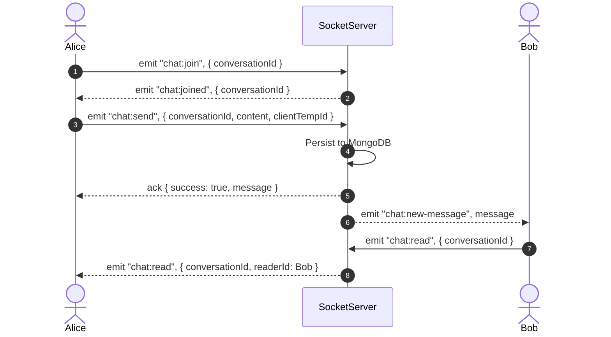
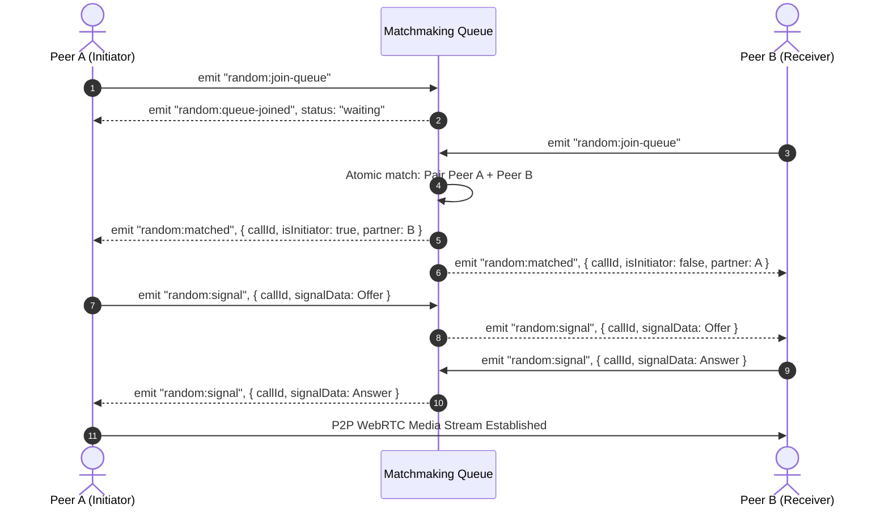

# Engaze.com — Backend API & Real-Time Signaling Server

[](https://nodejs.org/)
[](https://expressjs.com/)
[](https://mongoosejs.com/)
[](https://socket.io/)
[](https://render.com/)
[](https://opensource.org/licenses/ISC)

The core backend service for **Engaze.com** — a modern dating and social discovery platform. This service powers authenticated REST APIs for user identity, dating profiles, swipe discovery, mutual matching, persistent private messaging, as well as real-time WebSocket signaling for private chat and random 1-to-1 WebRTC video matchmaking.

---

## 🌐 Production & Repository Links

- **Live Base API:** [https://enagaze-com-backend.onrender.com](https://enagaze-com-backend.onrender.com)
- **Live Health Check:** [https://enagaze-com-backend.onrender.com/api/v1/health](https://enagaze-com-backend.onrender.com/api/v1/health)
- **Backend GitHub Repository:** [https://github.com/CrysPy-SAM/Enagaze.com-Backend](https://github.com/CrysPy-SAM/Enagaze.com-Backend)
- **Frontend Web Application:** [https://engaze-com.vercel.app](https://engaze-com.vercel.app)
- **Frontend GitHub Repository:** [https://github.com/CrysPy-SAM/Engaze.com-frontend.git](https://github.com/CrysPy-SAM/Engaze.com-frontend.git)

---

## 📋 Table of Contents

1. [Key Features](#-key-features)
2. [Technology Stack](#-technology-stack)
3. [Architecture & Folder Structure](#-architecture--folder-structure)
4. [Prerequisites](#-prerequisites)
5. [Installation & Local Setup](#-installation--local-setup)
6. [Environment Variables](#-environment-variables)
7. [Running the Server](#-running-the-server)
8. [Available npm Scripts](#-available-npm-scripts)
9. [REST API Reference](#-rest-api-reference)
10. [Authentication & Authorization](#-authentication--authorization)
11. [Database Schema & Indexing](#-database-schema--indexing)
12. [Socket.IO Events & Signaling](#-socketio-events--signaling)
13. [Testing & Verification](#-testing--verification)
14. [Render Deployment Guide](#-render-deployment-guide)
15. [Troubleshooting & Health Checks](#-troubleshooting--health-checks)
16. [Security Guidelines](#-security-guidelines)
17. [Current Limitations & Future Roadmap](#-current-limitations--future-roadmap)
18. [License](#-license)

---

## 🚀 Key Features

- **Authentication & Security:** Secure registration and login using `bcryptjs` password hashing (10 rounds) and signed `jsonwebtoken` (JWT) credentials.
- **Profile Management:** Comprehensive dating profiles with age calculation from Date of Birth, strict 18+ age validation, gender options, dating preferences, interests, bio, and multiple photo URLs.
- **Discovery Engine:** Paginated feed of prospective matches filtered by age range, mutual gender preferences, and profile completion status, automatically excluding self and previously swiped users.
- **Swipe & Match Algorithm:** Atomically handles `like` and `pass` actions with compound unique indexing. Creates deterministic, canonical mutual match records upon reciprocal likes.
- **Persistent Private Chat:** One-to-one conversation threads stored in MongoDB with unread message counts, chronological message history, read receipts, and idempotent message delivery via `clientTempId`.
- **Real-Time WebSocket Messaging:** Instant message broadcasting and read receipt synchronization across isolated Socket.IO conversation rooms.
- **Random 1-to-1 WebRTC Video Matchmaking:** Queue-based matching engine pairing two available users atomically with self-matching prevention, private room signaling (offer, answer, ICE candidates), skip-to-next, and disconnect cleanup.
- **Legacy Meeting Subsystem Safely Retired:** Obsolete room-based WebRTC meeting handlers and activity endpoints safely removed to eliminate unauthenticated URL-guessing access while preserving historical database records.
- **Health Check & Observability:** Dedicated root and `/api/v1/health` monitoring endpoints reporting MongoDB connection readiness and process uptime.
- **Configurable Cross-Origin Resource Sharing (CORS):** Dynamic origin validation supporting Vercel production domains, Vercel preview URLs (`*.vercel.app`), and local development environments.

---

## 🛠 Technology Stack

| Layer | Technologies |
| :--- | :--- |
| **Runtime Environment** | Node.js (ES Modules `"type": "module"`) |
| **Web Framework** | Express 4.18.2 |
| **Real-Time Communication** | Socket.IO 4.7.3 & WebRTC Signaling |
| **Database & ODM** | MongoDB with Mongoose 8.0.3 |
| **Authentication & Tokens** | JSON Web Tokens (`jsonwebtoken` 9.0.3) |
| **Password Encryption** | `bcryptjs` 3.0.3 (pure JavaScript binding, zero ELF compile errors) |
| **HTTP Status Constants** | `http-status` 1.7.3 |
| **Environment Management** | `dotenv` 17.2.3 |
| **Development Watcher** | `nodemon` 3.0.2 |

---

## 📁 Architecture & Folder Structure

```text
backend/
├── .env                  # Local environment file (DO NOT COMMIT)
├── .env.example          # Template showing required environment variables
├── .gitignore            # Git exclusion rules (node_modules, .env, logs)
├── package.json          # Project metadata, dependencies, and npm scripts
├── package-lock.json     # Locked dependency graph
└── src/
    ├── app.js            # Application entry point: Express, HTTP server, CORS, DB connection
    ├── controllers/
    │   ├── chat.controller.js       # Conversations, message pagination, read receipts
    │   ├── discovery.controller.js  # Candidate feed, swipes, mutual matches
    │   ├── randomCallManager.js     # Random video matchmaking queue & WebRTC signaling
    │   ├── socketManager.js         # Socket.IO initialization, JWT auth, private chat rooms
    │   └── user.controller.js       # Register, login, profile CRUD & Google Auth
    ├── middlewares/
    │   └── auth.middleware.js       # JWT extraction and validation middleware (`protect`)
    ├── models/
    │   ├── conversation.model.js    # Chat conversation metadata model
    │   ├── match.model.js           # Mutual dating match model
    │   ├── meeting.model.js         # Historical meeting activity model (preserved)
    │   ├── message.model.js         # Persistent chat message model with idempotency key
    │   ├── swipe.model.js           # Swipe action model (like/pass)
    │   └── user.model.js            # User account & dating profile schema
    └── routes/
        ├── chat.routes.js           # /api/v1/conversations endpoints
        ├── discovery.routes.js      # /api/v1/discovery endpoints
        ├── matches.routes.js        # /api/v1/matches endpoints
        └── users.routes.js          # /api/v1/users endpoints
```

---

## 📦 Prerequisites

Before running the backend locally or in production, ensure you have:

- **Node.js:** Version `18.0.0` or higher (verified on Node.js 20.x and Node.js 24.21.0 on Render).
- **npm:** Version `9.0.0` or higher.
- **MongoDB:** A running MongoDB instance, either:
  - Local MongoDB instance (`mongodb://127.0.0.1:27017/engaze`), or
  - MongoDB Atlas Cloud cluster URI (`mongodb+srv://...`).

---

## ⚙️ Installation & Local Setup

1. **Clone the repository:**
   ```bash
   git clone https://github.com/CrysPy-SAM/Enagaze.com-Backend.git
   cd Enagaze.com-Backend
   ```

2. **Install project dependencies:**
   ```bash
   npm install
   ```

3. **Configure Environment Variables:**
   Copy `.env.example` to create your local `.env` file:
   ```bash
   cp .env.example .env
   ```
   Edit `.env` with your actual MongoDB URI and secret keys (see [Environment Variables](#-environment-variables) below).

---

## 🔑 Environment Variables

The backend relies on the following environment variables loaded via `dotenv`:

| Variable Name | Required | Default in Code | Purpose |
| :--- | :---: | :--- | :--- |
| `PORT` | No | `8000` | Port on which the HTTP and WebSocket server listens. |
| `MONGO_URI` | **Yes** | *None* (warns if missing) | MongoDB connection string (Atlas or local). |
| `JWT_SECRET` | **Yes** (Prod) | *None* (Fails startup if missing in production) | Cryptographically secure secret (minimum 32 characters) used to sign and verify JWT authentication tokens. Generate with: `node -e "console.log(require('crypto').randomBytes(32).toString('hex'))"` |
| `JWT_EXPIRES_IN` | No | `7d` | Lifetime of issued JWT tokens (e.g., `7d`, `24h`). |
| `NODE_ENV` | No | `development` | Runtime mode (`development` or `production`). In non-production, CORS allows all origins. |
| `CLIENT_URL` | No | `https://engaze-com.vercel.app` | Explicit frontend origin allowed through CORS. |

### Example `.env` File
```env
PORT=8000
MONGO_URI=mongodb+srv://<username>:<password>@cluster0.example.mongodb.net/engaze?retryWrites=true&w=majority
JWT_SECRET=replace_with_a_secure_random_at_least_32_char_hex_secret_in_production
JWT_EXPIRES_IN=7d
NODE_ENV=development
CLIENT_URL=https://engaze-com.vercel.app
```

> [!WARNING]
> Never commit your `.env` file or hardcode credentials into source code. Always keep `.env` listed in `.gitignore`.

---

## 🏃 Running the Server

### Development Mode (with hot-reload via nodemon)
```bash
npm run dev
```

### Production Mode (standard Node.js execution)
```bash
npm start
```

Upon successful startup, the console will output:
```text
✅ MONGO Connected DB Host: <cluster-host>
🚀 Listening on PORT 8000
```

---

## 📜 Available npm Scripts

Defined in [`package.json`](file:///d:/code/Engaze.com/backend/package.json):

| Script | Command | Description |
| :--- | :--- | :--- |
| `npm run dev` | `nodemon src/app.js` | Runs server with auto-restart on file modifications. |
| `npm start` | `node src/app.js` | Standard production entry point (used by Render). |
| `npm run prod` | `pm2 src/app.js` | Starts server with PM2 process manager (requires PM2 installed globally or in environment). |

---

## 📡 REST API Reference

All application endpoints are served under the `/api/v1` prefix.

### Public / Monitoring Endpoints

#### 1. Service Health & Uptime
- **Method:** `GET`
- **Path:** `/`
- **Authentication:** None
- **Response `200 OK`:**
  ```json
  {
    "status": "ok",
    "service": "Engaze.com Backend API",
    "uptime": 1420,
    "timestamp": "2026-10-17T01:00:00.000Z"
  }
  ```

#### 2. Database Health Status
- **Method:** `GET`
- **Path:** `/api/v1/health`
- **Authentication:** None
- **Response `200 OK`:**
  ```json
  {
    "status": "healthy",
    "database": "connected",
    "timestamp": "2026-10-17T01:00:00.000Z"
  }
  ```

---

### Authentication Endpoints (`/api/v1/users`)

#### 3. Register New Account
- **Method:** `POST`
- **Path:** `/api/v1/users/register`
- **Authentication:** None
- **Request Body:**
  ```json
  {
    "name": "Jane Doe",
    "username": "janedoe",
    "password": "SecretPassword123!"
  }
  ```
- **Validation Rules:**
  - `name`: 2 to 100 characters.
  - `username`: 3 to 30 characters, alphanumeric with dots, underscores, and hyphens (`^[a-zA-Z0-9_.-]+$`).
  - `password`: minimum 6 characters.
- **Response `201 Created`:**
  ```json
  {
    "success": true,
    "message": "User registered successfully",
    "token": "eyJhbGciOiJIUzI1NiIsIn...",
    "user": {
      "id": "67104b7...",
      "name": "Jane Doe",
      "username": "janedoe",
      "isProfileComplete": false,
      "photos": [],
      "interests": []
    }
  }
  ```
- **Error Responses:** `400 Bad Request` (validation failed), `409 Conflict` (username taken).

#### 4. User Login
- **Method:** `POST`
- **Path:** `/api/v1/users/login`
- **Authentication:** None
- **Request Body:**
  ```json
  {
    "username": "janedoe",
    "password": "SecretPassword123!"
  }
  ```
- **Response `200 OK`:**
  ```json
  {
    "success": true,
    "token": "eyJhbGciOiJIUzI1NiIsIn...",
    "user": {
      "id": "67104b7...",
      "name": "Jane Doe",
      "username": "janedoe",
      "isProfileComplete": false
    }
  }
  ```
- **Error Responses:** `400 Bad Request` (missing fields), `401 Unauthorized` (invalid credentials).

---

### User Profile Endpoints (`/api/v1/users`)

#### 5. Get Current User Profile
- **Method:** `GET`
- **Path:** `/api/v1/users/profile/me`
- **Authentication:** Required (`Authorization: Bearer <token>`)
- **Response `200 OK`:**
  ```json
  {
    "success": true,
    "profile": {
      "id": "67104b7...",
      "name": "Jane Doe",
      "username": "janedoe",
      "dob": "2000-05-15T00:00:00.000Z",
      "age": 26,
      "gender": "female",
      "datingPreferences": {
        "interestedIn": ["male", "everyone"],
        "ageRange": { "min": 21, "max": 35 }
      },
      "bio": "Coffee enthusiast and traveler.",
      "photos": ["https://images.unsplash.com/..."],
      "interests": ["Coffee ☕", "Travel ✈️"],
      "isProfileComplete": true
    }
  }
  ```

#### 6. Update Current User Profile
- **Method:** `PUT`
- **Path:** `/api/v1/users/profile/me`
- **Authentication:** Required (`Authorization: Bearer <token>`)
- **Editable Fields:** `name`, `dob`, `gender` (`male` | `female` | `non-binary` | `other`), `datingPreferences`, `bio` (max 500 chars), `photos` (array of URLs), `interests` (array of strings).
- **Validation Rules:** Age must be $\ge 18$ years if `dob` is provided. Automatically computes `isProfileComplete: true` when `gender`, `photos` (at least 1), and `dob` are populated.
- **Response `200 OK`:** Returns updated profile object.

#### 7. User Meeting History (Retired)
- **`GET /api/v1/users/get_all_activity`** & **`POST /api/v1/users/add_to_activity`:** Safely retired (HTTP 404). Existing MongoDB records and schema preserved.

---

### Dating Discovery & Matching Endpoints

#### 8. Get Discovery Candidate Feed
- **Method:** `GET`
- **Path:** `/api/v1/discovery?page=1&limit=10`
- **Authentication:** Required (`Authorization: Bearer <token>`)
- **Query Parameters:**
  - `page` (optional, default: `1`)
  - `limit` (optional, default: `10`, max: `30`)
- **Filtering Logic:**
  - Excludes user's own profile.
  - Excludes all profiles previously swiped (`like` or `pass`).
  - Requires `isProfileComplete: true`.
  - Matches user's `datingPreferences.interestedIn` and reciprocal gender preference.
  - Matches user's `datingPreferences.ageRange` against target's Date of Birth.
- **Response `200 OK`:**
  ```json
  {
    "success": true,
    "page": 1,
    "limit": 10,
    "total": 5,
    "totalPages": 1,
    "profiles": [
      {
        "id": "67104b9...",
        "name": "Alex",
        "username": "alex99",
        "age": 25,
        "gender": "male",
        "bio": "Adventurer and photographer.",
        "photos": ["https://..."],
        "interests": ["Photography 📷", "Hiking 🏔️"]
      }
    ]
  }
  ```

#### 9. Submit Swipe Action
- **Method:** `POST`
- **Path:** `/api/v1/discovery/swipe`
- **Authentication:** Required (`Authorization: Bearer <token>`)
- **Request Body:**
  ```json
  {
    "targetUserId": "67104b9...",
    "action": "like"
  }
  ```
- **Response (No Mutual Match yet or Pass):**
  ```json
  {
    "success": true,
    "action": "like",
    "isMatch": false
  }
  ```
- **Response `201 Created` (Mutual Match Detected!):**
  ```json
  {
    "success": true,
    "action": "like",
    "isMatch": true,
    "match": {
      "_id": "67104bc...",
      "matchedUser": {
        "id": "67104b9...",
        "name": "Alex",
        "username": "alex99",
        "photos": ["https://..."]
      },
      "createdAt": "2026-10-17T01:05:00.000Z"
    }
  }
  ```
- **Error Responses:** `400 Bad Request` (self-swipe or invalid ID), `409 Conflict` (already swiped on this user).

#### 10. Get Mutual Matches
- **Method:** `GET`
- **Path:** `/api/v1/matches?page=1&limit=20`
- **Authentication:** Required (`Authorization: Bearer <token>`)
- **Response `200 OK`:**
  ```json
  {
    "success": true,
    "total": 1,
    "page": 1,
    "limit": 20,
    "totalPages": 1,
    "matches": [
      {
        "_id": "67104bc...",
        "matchedUser": {
          "id": "67104b9...",
          "name": "Alex",
          "username": "alex99",
          "photos": ["https://..."]
        },
        "createdAt": "2026-10-17T01:05:00.000Z"
      }
    ]
  }
  ```

---

### Private Chat & Conversations Endpoints (`/api/v1/conversations`)

All conversation endpoints require `Authorization: Bearer <token>`.

| Method | Path | Description |
| :--- | :--- | :--- |
| `GET` | `/api/v1/conversations` | Lists user's active conversations sorted by `lastMessageAt`, with unread counts and partner info. |
| `GET` | `/api/v1/conversations/match/:matchId` | Gets or initializes a conversation record for a verified mutual match. |
| `GET` | `/api/v1/conversations/:conversationId/messages` | Paginated chronological message history (`page`, `limit`). Verifies caller is a participant. |
| `POST` | `/api/v1/conversations/:conversationId/messages` | REST fallback to send message. Body: `{ "content": "Hello!", "clientTempId": "uuid" }`. |
| `PUT` | `/api/v1/conversations/:conversationId/read` | Marks all incoming messages in the conversation as read by current user. |

---

## 🔒 Authentication & Authorization

1. **Token Generation:** Upon successful registration or login, the server issues a signed JWT containing `{ id: user._id, username: user.username }` with a configurable lifespan (default: 7 days).
2. **HTTP Authorization Header:** Protected endpoints require the HTTP header:
   ```http
   Authorization: Bearer <token>
   ```
3. **Middleware Verification:** [`src/middlewares/auth.middleware.js`](file:///d:/code/Engaze.com/backend/src/middlewares/auth.middleware.js) intercepts the request, verifies the signature against `JWT_SECRET`, checks token expiration, and loads the user into `req.user` (with the hashed password excluded).
4. **WebSocket Authentication:** During the Socket.IO handshake, the token is extracted from `socket.handshake.auth.token` or the HTTP `Authorization` header and verified before granting access to private rooms.

---

## 🗄 Database Schema & Indexing

All models are built with MongoDB & Mongoose schemas:

### Models Summary
- **`User`** ([`src/models/user.model.js`](file:///d:/code/Engaze.com/backend/src/models/user.model.js)): Core identity and dating profile.
  - Virtual `age` property computed on-the-fly from Date of Birth.
  - `toJSON` transform automatically deletes `password` and `__v` before serialization.
  - Unique index on `username` (lowercase).
- **`Swipe`** ([`src/models/swipe.model.js`](file:///d:/code/Engaze.com/backend/src/models/swipe.model.js)): Records one-way swipe decisions.
  - Compound unique index: `{ fromUser: 1, toUser: 1 }` prevents duplicate swipes at database level.
- **`Match`** ([`src/models/match.model.js`](file:///d:/code/Engaze.com/backend/src/models/match.model.js)): Mutual dating matches.
  - Unique index on `userPair`: canonical formatted string (`minId_maxId`) guarantees strictly one match record per user pair.
  - Index on `users: 1` for fast user match queries.
- **`Conversation`** ([`src/models/conversation.model.js`](file:///d:/code/Engaze.com/backend/src/models/conversation.model.js)): Thread metadata between matched peers.
  - Unique index on `match: 1`.
  - Compound index: `{ participants: 1, lastMessageAt: -1 }`.
- **`Message`** ([`src/models/message.model.js`](file:///d:/code/Engaze.com/backend/src/models/message.model.js)): Persistent chat messages.
  - Sparse unique compound index: `{ conversation: 1, clientTempId: 1 }` guarantees idempotent message creation upon network retry.
  - Compound indexes on `{ conversation: 1, createdAt: 1 }`.
- **`Meeting`** ([`src/models/meeting.model.js`](file:///d:/code/Engaze.com/backend/src/models/meeting.model.js)): Meeting code history logs.

---

## ⚡ Socket.IO Events & Signaling

Socket.IO is mounted alongside Express on the same HTTP server (`/socket.io/`).

### 1. Match-Based Private Chat



| Event Name | Direction | Payload | Description |
| :--- | :---: | :--- | :--- |
| `chat:join` | Client $\rightarrow$ Server | `{ conversationId }` | Authenticated socket joins isolated room `conversation:<id>`. |
| `chat:joined` | Server $\rightarrow$ Client | `{ conversationId }` | Acknowledgment of room join. |
| `chat:send` | Client $\rightarrow$ Server | `{ conversationId, content, clientTempId }` | Persists message to DB, updates conversation, and broadcasts. |
| `chat:new-message` | Server $\rightarrow$ Client | Message object | Emitted to participants in the room when a message is sent. |
| `chat:read` | Client $\rightarrow$ Server | `{ conversationId }` | Marks messages read and broadcasts read receipt to room. |
| `chat:error` | Server $\rightarrow$ Client | `{ message }` | Dispatched if authorization or validation fails. |

---

### 2. Random 1-to-1 WebRTC Video Matchmaking

Implemented in [`src/controllers/randomCallManager.js`](file:///d:/code/Engaze.com/backend/src/controllers/randomCallManager.js).



| Event Name | Direction | Payload | Description |
| :--- | :---: | :--- | :--- |
| `random:join-queue` | Client $\rightarrow$ Server | *(Empty or metadata)* | Enters matchmaking queue. Atomically pairs with waiting peer or enqueues. |
| `random:queue-joined`| Server $\rightarrow$ Client | `{ status: "waiting" }` | Confirms user is waiting in queue. |
| `random:matched` | Server $\rightarrow$ Client | `{ callId, isInitiator, partner }` | Emitted to both peers. One is assigned `isInitiator: true`. |
| `random:signal` | Bidirectional | `{ callId, signalData, senderId }` | Relays WebRTC Offer, Answer, and ICE candidates strictly to call partner. |
| `random:leave-queue`| Client $\rightarrow$ Server | *(Empty)* | Safely removes caller from matchmaking queue. |
| `random:end-call` | Client $\rightarrow$ Server | `{ callId }` | Terminates active call session and notifies partner. |
| `random:next` | Client $\rightarrow$ Server | `{ callId }` | Skips current partner, terminates call, and emits `random:rejoin-queue`. |
| `random:call-ended` | Server $\rightarrow$ Client | `{ callId, reason }` | Informs remaining participant that the session ended. |

---

## 🧪 Testing & Verification

The backend has been verified using automated integration suites executed directly against both local development servers and the live Render production deployment.

### Live Production Verification Results
```text
================================================================================
ENGAZE.COM LIVE PRODUCTION INTEGRATION TEST SUITE
Backend Target: https://enagaze-com-backend.onrender.com
================================================================================
[PASS]  1. Live Health Check: Database connected, uptime active
[PASS]  2. Live User Registration: Auth token & user profile created
[PASS]  3. Live User Login: JWT authentication succeeded
[PASS]  4. Live Authenticated Profile Fetch: Data matches registered user
[PASS]  5. Live Profile Update: Bio & dating preferences updated
[PASS]  6. Live Discovery Feed: HTTP 200 with candidates array
[PASS]  7. Live Matches List: HTTP 200 with matches array
[PASS]  8. Live Conversations List: HTTP 200 with active threads
[PASS]  9. Live Socket.IO Auth Connection: Connected via websocket
[PASS] 10. Live Socket.IO Queue Join: "queue_joined" event acknowledged
[PASS] 11. Live Socket.IO Queue Cancel: "queue_left" event acknowledged

Test Results: 11 Passed, 0 Failed (100% Success Rate)
```

To run a verification test locally:
1. Ensure your backend is running (`npm start` or `npm run dev`).
2. Run curl or test scripts targeting `http://localhost:8000/api/v1/health`.

---

## ☁️ Render Deployment Guide

The backend is configured for deployment as a **Web Service** on [Render](https://render.com).

### Render Service Settings

| Setting | Value |
| :--- | :--- |
| **Service Name** | `Enagaze.com-Backend-1` |
| **Environment** | `Node` |
| **Region** | Oregon (US West) or closest to MongoDB cluster |
| **Branch** | `main` |
| **Root Directory** | *(Leave blank if repository root is backend)* |
| **Build Command** | `npm install` |
| **Start Command** | `npm start` |

### Required Environment Variables on Render Dashboard
In your Render Dashboard $\rightarrow$ **Environment**:
1. `MONGO_URI`: `mongodb+srv://<username>:<password>@cluster0.example.mongodb.net/engaze?retryWrites=true&w=majority`
2. `JWT_SECRET`: `<secure-random-string>`
3. `JWT_EXPIRES_IN`: `7d`
4. `NODE_ENV`: `production`
5. `CLIENT_URL`: `https://engaze-com.vercel.app`

> [!NOTE]
> Render free tier web services spin down after 15 minutes of inactivity. When a new request arrives, Render takes approximately 30–50 seconds to cold-start the container.

---

## 🔍 Troubleshooting & Health Checks

### 1. MongoDB Connection Timeouts
- **Symptom:** `MongooseServerSelectionError: connect ECONNREFUSED` or `MongoNetworkTimeoutError`.
- **Cause:** MongoDB Atlas Network Access rules.
- **Fix:** In MongoDB Atlas $\rightarrow$ **Network Access**, ensure IP `0.0.0.0/0` (Allow Access from Anywhere) is added, or add Render's outbound IP ranges.

### 2. Invalid ELF Header / Native Dependency Crash
- **Symptom:** `Error: .../bcrypt_lib.node: invalid ELF header`.
- **Cause:** Using native `bcrypt` compiled on Windows locally and pushed into Linux containers.
- **Fix:** The codebase uses `bcryptjs` (pure JavaScript), which requires no native compilation. Ensure `package.json` retains `"bcryptjs": "^3.0.3"`.

### 3. CORS Policy Blocked
- **Symptom:** `Access to fetch at ... from origin 'https://engaze-com.vercel.app' has been blocked by CORS policy`.
- **Cause:** Origin not recognized or credentials omitted.
- **Fix:** The backend dynamically validates origins ending in `.vercel.app` and explicitly sets `access-control-allow-credentials: true`. Ensure requests from the client include `withCredentials: true` if credentials are required.

---

## 🛡 Security Guidelines

1. **Never Commit Secrets:** `.env` is ignored by Git. Never hardcode database connection strings, passwords, or JWT secrets in code or commits.
2. **Password Hashing:** Passwords are never stored in plaintext. `bcryptjs.hash(password, 10)` runs prior to persisting user records.
3. **Payload Sanitization:** Mongoose `toJSON` transforms automatically strip `password` and internal version keys (`__v`) from all output objects.
4. **Rate & Size Limits:** Express request body limits are restricted to `40kb` in [`src/app.js`](file:///d:/code/Engaze.com/backend/src/app.js) to mitigate denial-of-service attempts via large payloads.

---

## 🗺 Current Limitations & Future Roadmap

- **In-Memory Queue:** Matchmaking queue and active call mappings currently reside in server memory. For multi-instance horizontal scaling, implement a Redis adapter (`socket.io-redis`) and Redis-backed queues.
- **Media Storage:** Profile photos currently store external image URLs. Future improvement includes direct photo upload via Amazon S3 or Cloudinary with automatic image optimization.
- **TURN Relay Servers:** WebRTC peer connections currently utilize Google STUN servers. In restrictive symmetric NAT environments, adding dedicated TURN relay servers (e.g., Coturn or Twilio Network Traversal) will ensure 100% peer connectivity.

---

## 📄 License

This project is licensed under the **ISC License** as specified in [`package.json`](file:///d:/code/Engaze.com/backend/package.json):

```text
ISC License

Copyright (c) 2026 Engaze.com Contributors

Permission to use, copy, modify, and/or distribute this software for any
purpose with or without fee is hereby granted, provided that the above
copyright notice and this permission notice appear in all copies.
```

