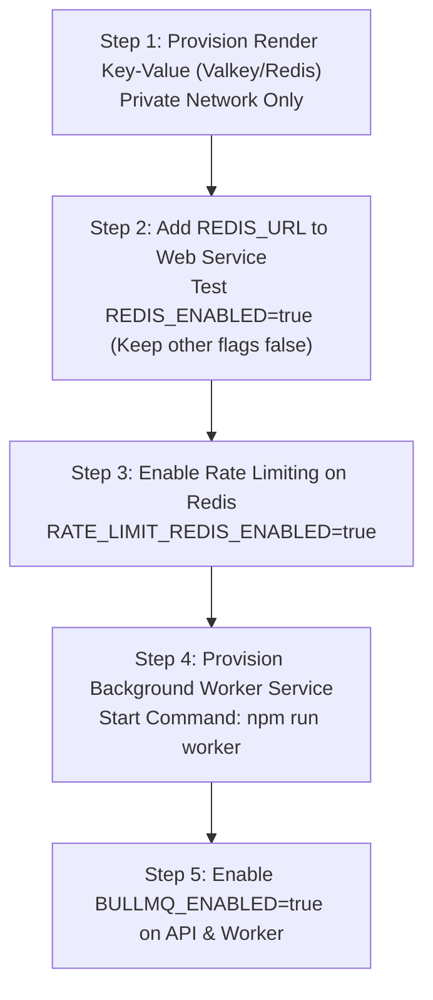

# Engaze.com — Render & Vercel Production Deployment Runbook (Phase 5B)

> **Current Status**: Live in Production  
> **Frontend**: Vercel (`https://www.engaze.date` & `https://engaze-com.vercel.app`)  
> **Backend API**: Render Web Service (`https://enagaze-com-backend.onrender.com`)  
> **Database**: MongoDB Atlas Cluster  
> **Storage**: AWS S3 Presigned Media Storage  
> **Distributed Flags**: Disabled in production (`REDIS_ENABLED=false`, `BULLMQ_ENABLED=false`) — Single-Instance In-Memory Resilient Mode  

---

## 1. Current Deployment Topology & Verified Facts

```
                      +-----------------------------------+
                      |   Vercel Edge Network             |
                      |   - https://www.engaze.date       |
                      |   - https://engaze-com.vercel.app |
                      +-----------------+-----------------+
                                        | (HTTPS / WSS)
                                        v
                      +-----------------------------------+
                      |   Render Web Service              |
                      |   - Enagaze.com-Backend-1         |
                      |   - Native Node.js runtime        |
                      |   - Build: npm install            |
                      |   - Start: npm start              |
                      |   - Port: 10000 (Render dynamic)  |
                      +--------+-----------------+--------+
                               |                 |
                   (MongoDB Wire)                (AWS SigV4)
                               v                 v
                      +----------------+   +---------------+
                      | MongoDB Atlas  |   |    AWS S3     |
                      | Shared Cluster |   | Profile Media |
                      +----------------+   +---------------+
```

### Verified Live Probes (Executed October 26, 2026):
1. **Frontend Root & Custom Domain**:
   - `https://engaze.date` returns `308 Permanent Redirect` to `https://www.engaze.date/` via Vercel edge router (`Server: Vercel`).
   - `https://www.engaze.date/` returns `200 OK` (`Permissions-Policy: camera=(self), microphone=(self)`).
   - `https://engaze-com.vercel.app/` returns `200 OK`.
2. **Backend Live API Health**:
   - `GET https://enagaze-com-backend.onrender.com/api/v1/health` returns:
     ```json
     {
       "status": "healthy",
       "ready": true,
       "database": "connected",
       "uptime": 465,
       "timestamp": "2026-10-26T15:53:47.364Z"
     }
     ```
   - **Verification Note**: `redis` and `bullmq` fields are completely absent from the live payload. This verifies that `REDIS_ENABLED` and `BULLMQ_ENABLED` are safely inactive in production.
3. **Frontend Target Detection**:
   - `frontend/src/environment.js` resolves:
     - At runtime, if hostname is not `localhost` / `127.0.0.1`, it points directly to `https://enagaze-com-backend.onrender.com`.
     - Permitted CORS allowlist in `backend/src/config/cors.js` explicitly includes `https://engaze.date`, `https://www.engaze.date`, and `https://engaze-com.vercel.app`.

---

## 2. Invariants: What Must Stay Unchanged

To prevent any disruption to live users:

### 2.1 Existing Render Web Service
- **Do NOT switch the Render service environment to Docker** without pre-staging. The live service currently runs as a native **Node** environment using `npm install` and `npm start`.
- **Do NOT alter existing build or start commands** on the live Render web service:
  - Build Command: `npm install`
  - Start Command: `npm start`
- **Do NOT change the Render service port handling**: Render injects `PORT` (usually `10000`), which `src/app.js` respects via `process.env.PORT || 8000`.
- **Do NOT change `trust proxy`**: Express is configured with `app.set("trust proxy", 1)` to resolve client IPs accurately behind Render's reverse proxy without IP spoofing.

### 2.2 Existing Vercel Frontend & Custom Domain
- **Do NOT change DNS records** for `engaze.date` or `www.engaze.date`.
- **Do NOT rename or replace** the production backend domain `https://enagaze-com-backend.onrender.com` without updating `frontend/src/environment.js` and re-deploying the frontend.

---

## 3. Environment Variables Reference

### 3.1 Live API Web Service (Current Production)

| Variable Name | Required | Purpose / Constraints |
|---|:---:|---|
| `NODE_ENV` | Yes | Set to `production`. |
| `PORT` | Auto | Injected automatically by Render (do not override). |
| `MONGO_URI` | Yes | MongoDB Atlas connection string (`mongodb+srv://...`). |
| `JWT_SECRET` | Yes | Minimum 32-character high-entropy secret. Fails closed on startup if missing. |
| `JWT_EXPIRES_IN` | Yes | Standard session token lifespan (e.g. `7d`). |
| `CLIENT_URL` | Yes | Primary frontend URL: `https://www.engaze.date`. |
| `ALLOWED_ORIGINS` | Optional | Additional origins (e.g. `https://engaze-com.vercel.app,https://engaze.date`). |
| `STORAGE_PROVIDER` | Yes | `s3` for AWS S3 photo storage. |
| `AWS_ACCESS_KEY_ID` | Yes | IAM credentials for S3 operations. |
| `AWS_SECRET_ACCESS_KEY` | Yes | IAM secret for S3 operations. |
| `AWS_REGION` | Yes | S3 bucket AWS region (e.g. `ap-southeast-2`). |
| `AWS_S3_BUCKET` | Yes | Target S3 bucket name. |
| `REDIS_ENABLED` | **No** | Default `false` in production. Keep unset/false until Redis is provisioned. |
| `BULLMQ_ENABLED` | **No** | Default `false` in production. Keep unset/false. |

### 3.2 Optional Background Worker Service (Future Infrastructure)

If a separate Render Background Worker is provisioned in the future, it requires:

| Variable Name | Required | Purpose / Constraints |
|---|:---:|---|
| `NODE_ENV` | Yes | Set to `production`. |
| `REDIS_ENABLED` | Yes | Set to `true` (worker cannot run without Redis). |
| `REDIS_URL` | Yes | Internal Render Valkey/Redis URL (e.g. `redis://red-xxxx:6379`). |
| `BULLMQ_ENABLED` | Yes | Set to `true`. |
| `BULLMQ_KEY_PREFIX` | Optional | Namespace prefix, default `engaze:bullmq`. |
| `BULLMQ_CONCURRENCY`| Optional | Bounded job concurrency (default `5`, max `50`). |
| `AWS_*` credentials | Yes | Required to execute S3 deletion in `mediaCleanup.worker.js`. |

---

## 4. Architectural Evaluation: Do We Need a Worker & Redis Right Now?

### 4.1 Real Code Behavior When BullMQ is Disabled
In [src/services/storage.service.js](file:///d:/code/Engaze.com/backend/src/services/storage.service.js):
```javascript
export async function dispatchMediaCleanup({ key, userId, adapter }) {
    if (isBullMQEnabled()) {
        try {
            await enqueueMediaCleanup({ key, userId });
            return;
        } catch (enqueueErr) {
            console.warn("BullMQ enqueue failed; falling back to inline deletion:", enqueueErr?.message);
        }
    }
    // Fallback or disabled path: delete inline
    try {
        const effectiveAdapter = adapter || getStorageAdapter();
        if (effectiveAdapter && typeof effectiveAdapter.deleteObject === "function") {
            await effectiveAdapter.deleteObject(key);
        }
    } catch (cleanupErr) {
        console.warn("Non-fatal storage object cleanup error:", cleanupErr?.message);
    }
}
```
**Key Finding**:
1. When `BULLMQ_ENABLED=false`, the server deletes obsolete S3 photos inline within the request lifecycle.
2. The deletion call is wrapped in a defensive `try...catch` block. Even if S3 fails, user photo updates succeed without throwing an HTTP 500.
3. Media replacement is a low-frequency user action (profile photo changes). It does not create significant event-loop blocking.

### 4.2 Render Cost & Plan Considerations
- **Render Web Services**: Have a Free tier option (512MB RAM, spins down after 15m inactivity).
- **Render Background Workers**: **NO FREE TIER**. Render requires a minimum **Starter** plan ($7/month) to run a background worker.
- **Render Key-Value (Redis/Valkey)**:
  - Render Free Redis: Ephemeral, 25MB RAM, and automatically deleted after 30 days. Unsuitable for production.
  - Render Paid Valkey/Redis: Starts at $7/month (Starter tier, 256MB).
- **Total Added Cost**: Provisioning a separate Background Worker + persistent Redis on Render adds at least **$14/month**.

### 4.3 Recommendation: Safest Next Step
**Do NOT provision a Render Background Worker or enable BullMQ in production at this time.**

The application is currently running smoothly as a single-instance Web Service. The inline fallback path for media cleanup is tested, resilient, and non-blocking. 

Only introduce Redis and Background Workers when:
1. Horizontal scaling across 2+ Web Service instances is required (necessitating distributed presence and Socket.IO adapter).
2. Asynchronous job throughput exceeds inline request capacity (e.g., video processing or batch email generation).

---

## 5. Controlled Future Rollout Sequence (If Scaling to Redis & Worker)

If and when distributed coordination is required, execute in this exact sequence:



### Step 1: Provision Render Key-Value (Valkey/Redis)
1. In Render Dashboard $\rightarrow$ **New +** $\rightarrow$ **Key-Value (Redis/Valkey)**.
2. Select the same region as the Web Service (e.g., Oregon).
3. Choose the Starter plan ($7/mo) with persistent storage.
4. Note the **Internal Connection String** (e.g., `redis://red-xxxx:6379`). **Never use the external connection string for backend services.**

### Step 2: Validate Private Network Connectivity
From the Render Web Service Shell (or via `/api/v1/health` probe):
1. Add `REDIS_URL` pointing to the internal Redis URL.
2. Set `REDIS_ENABLED=true`. Keep all other flags (`BULLMQ_ENABLED`, `SOCKET_IO_REDIS_ADAPTER_ENABLED`, etc.) `false`.
3. Verify that `/api/v1/health` reports `"redis": "connected"` and status `200 OK`.

### Step 3: Provision the Render Background Worker
1. In Render Dashboard $\rightarrow$ **New +** $\rightarrow$ **Background Worker**.
2. Connect repository `Enagaze.com-Backend`.
3. Set:
   - **Environment**: `Node`
   - **Build Command**: `npm install`
   - **Start Command**: `npm run worker`
   - **Instance Type**: Starter ($7/mo)
4. Configure Worker Environment Variables:
   - `NODE_ENV=production`
   - `REDIS_ENABLED=true`
   - `REDIS_URL=<internal-valkey-url>`
   - `BULLMQ_ENABLED=true`
   - `AWS_*` S3 credentials
5. **Health Checks on Background Workers**:
   - Render Background Workers do **not** have public ports and do **not** support HTTP health check paths.
   - Do **NOT** configure a health check path for the background worker service. Render monitors the worker process directly via PID and exit status.

### Step 4: Enable BullMQ on the API Web Service
1. On the Web Service, add `BULLMQ_ENABLED=true`.
2. Deploy and check `/api/v1/health`: verify `"bullmq": "connected"` appears in the payload.

---

## 6. Smoke Tests & Verification Checklist

Execute these smoke tests after any production configuration change:

### 6.1 Website & Routing Smoke Test
- [ ] Open `https://www.engaze.date` in an incognito window.
- [ ] Confirm landing page loads with zero console errors.
- [ ] Confirm WebRTC device permissions prompt (camera/mic) functions as expected.

### 6.2 Health & Readiness Probes
```bash
# Liveness probe: confirms HTTP listener is responsive
curl -i https://enagaze-com-backend.onrender.com/health

# Expected: HTTP 200 OK, {"status":"ok","service":"Engaze.com Backend API",...}

# Readiness probe: confirms database and active services
curl -i https://enagaze-com-backend.onrender.com/api/v1/health

# Expected: HTTP 200 OK, {"status":"healthy","ready":true,"database":"connected",...}
```

### 6.3 Authentication Smoke Test
- [ ] Log in with an existing user account or register a test account on `https://www.engaze.date`.
- [ ] Confirm JWT token is returned and stored in localStorage.
- [ ] Confirm profile page loads user data from `GET /api/v1/users/profile`.

### 6.4 Profile Photo Upload & Cleanup Smoke Test
- [ ] Upload a new profile photo (valid JPEG/PNG/WebP, <5MB).
- [ ] Verify image preview displays and saves.
- [ ] Upload a replacement photo.
- [ ] Verify that:
  - When BullMQ is disabled: S3 deletion occurs inline immediately without errors.
  - When BullMQ is enabled: Check worker logs in Render Dashboard to see:
    `[BullMQ:Worker] Job media-cleanup-... (cleanup-object) completed successfully.`

---

## 7. Rollback Procedures

### 7.1 Instant Rollback via Environment Variables (Zero-Downtime)
If any Redis or BullMQ issue occurs, revert immediately without redeploying code:
1. In Render Dashboard $\rightarrow$ Web Service $\rightarrow$ **Environment**:
   - Set `BULLMQ_ENABLED=false`
   - Set `REDIS_ENABLED=false`
2. Save changes. Render restarts the Node.js process gracefully.
3. The server immediately falls back to local in-memory operation and inline S3 deletion.

### 7.2 Service Rollback via Render Deploy History
1. In Render Dashboard $\rightarrow$ Web Service $\rightarrow$ **Events**.
2. Locate the previous successful deploy.
3. Click **Rollback to this deploy**.

---

## 8. Dashboard Information Checklist (For Operator Inspection)

Since dashboard settings cannot be programmatically verified without credentials, check these settings manually in your dashboards:

### Render Dashboard Checklist:
- [ ] **Instance Plan**: Check whether `Enagaze.com-Backend-1` is on the **Free** tier or a paid plan (Starter/Standard).
- [ ] **Node.js Version**: Confirm the active Node version in Render build settings or via `NODE_VERSION` environment variable.
- [ ] **Health Check Path**: Confirm whether Health Check Path is set in Render service settings (recommended: `/api/v1/health` or `/health`).
- [ ] **Auto-Deploy**: Check whether **Auto-Deploy** is enabled for pushes to the `main` branch.

### Vercel Dashboard Checklist:
- [ ] **Environment Variables**: Confirm whether `REACT_APP_API_URL` is set in Vercel project settings or if it relies on `environment.js` fallback (`https://enagaze-com-backend.onrender.com`).
- [ ] **Domains**: Confirm `engaze.date` and `www.engaze.date` both show green checkmarks (Valid Configuration) in Vercel $\rightarrow$ Settings $\rightarrow$ Domains.

